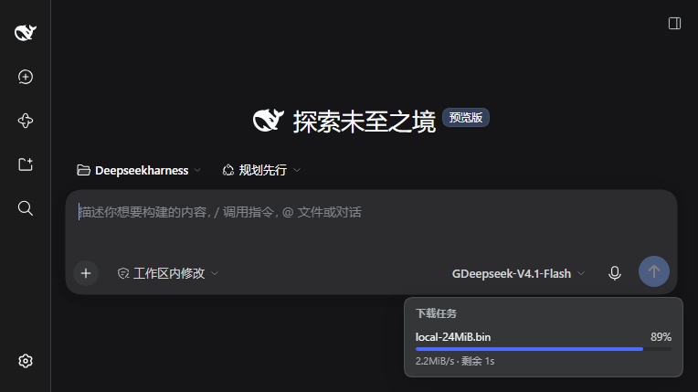

# dsh-smart-dl

[](https://www.npmjs.com/package/@leisureyu/dsh-smart-dl)
[](https://www.npmjs.com/package/@leisureyu/dsh-smart-dl)
[](./LICENSE)
[](https://github.com/LeiSureYu/dsh-smart-download/actions/workflows/publish.yml)


[简体中文](./README.md) · English

> A downloader for [DeepSeek Harness (DSH)](https://github.com/deepseek-ai) with
> bundled aria2: automatic multi-connection for large files, curl fallback,
> resumable downloads, checksum verification against the official docs.
> **All six platforms fully supported — Windows / Linux / macOS. HarmonyOS available since 1.9.1.**



## Install

In the DSH sidebar **Plugins → Add plugin**, paste the package name, then restart DSH:

```
@leisureyu/dsh-smart-dl
```

Command line (desktop DSH: use its own bundled CLI):

```bash
dsh plugin --profile web add @leisureyu/dsh-smart-dl
```

## Quick start

**Basic download** — automatic probing, multi-connection, resume:

```jsonc
smart_download({ "url": "https://example.com/tool-1.4.0.zip" })
```

**Verify against the official docs** — checksum + mirror (a proven same-origin GitHub mirror is picked automatically):

```jsonc
smart_download({
  "url": "https://github.com/owner/repo/releases/download/v1.4.0/tool.zip",
  "sha256": "9f86d081884c7d659a2feaa0c55ad015a3bf4f1b2b0b822cd15d6c15b0f00a08",
  "mirror": "auto"
})
```

**A whole batch** — concurrent, capped, per-entry results; one failure never aborts the rest:

```jsonc
smart_download({
  "targets": [
    { "url": "https://example.com/a.iso", "output": "a.iso" },
    { "url": "https://example.com/b.iso", "sha256": "…" }
  ],
  "maxBandwidth": "4M",
  "timeoutMs": 600000
})
```

**In the background** — returns a `taskId` immediately; the panel shows it as usual:

```jsonc
smart_download({ "url": "https://example.com/big.iso", "background": true })
// poll download_status(taskId); cancel / retry from the download manager
```

## Features

| Feature | How |
| --- | --- |
| Multi-connection (4/8 by size, automatic curl fallback) | default |
| Resume (same-origin fingerprint check) | default |
| Checksum verification | `sha256` / `checksum` (MD5 / SHA-1 / SHA-256 / SHA-512) |
| Expected-size verification | `expectedSize` |
| Mirror acceleration (verified same-origin, automatic) | `mirror: "auto"` |
| Proxy (probe / mirror / download all consistent, `NO_PROXY` aware) | `proxy` |
| Batch downloads | `targets` + `maxBandwidth` + `timeoutMs` |
| Background execution | `background: true` |
| Existing-file policy | `ifExists: "overwrite" \| "skip" \| "rename"` |
| Custom headers (credentials travel over stdin, never in argv) | `userAgent` / `referer` / `headers` |
| Server-supplied filenames / disk-space preflight | default |

## smart_download parameters

| Parameter | Type | Notes |
| --- | --- | --- |
| `url` / `targets` | string / array | **Exactly one**. Batches: max 50 entries, per-entry results. |
| `output` | string | Output path; defaults to `Content-Disposition` → query param → URL segment. |
| `sha256` | string | Expected SHA-256. Bare hex, `sha256:<hex>`, SRI forms all accepted. |
| `checksum` | string | Same, plus MD5 / SHA-1 / SHA-512 (inferred from length). Mutually exclusive with `sha256`. |
| `expectedSize` | integer | Expected bytes (the size the docs print). Conflicts with the declared length are rejected before downloading. |
| `ifExists` | string | `overwrite` (default) / `skip` / `rename`. |
| `mirror` | string | Mirror prefix (e.g. `https://gh-proxy.com/`) or `"auto"`. |
| `proxy` | string | http(s) proxy, shared by probe / mirror / download. Falls back to `HTTPS_PROXY` etc. |
| `userAgent` / `referer` / `headers` | string / object | Extra request headers, shared by probe and download. |
| `maxBandwidth` | string | Total bandwidth cap for the call, e.g. `"2M"`, `"500K"`, `"1500000"`. |
| `timeoutMs` | integer | Per-entry timeout (1000–1800000 ms). |
| `background` | boolean | Run in the background; returns `taskId` / batch id immediately. |

## download_status parameters

| Parameter | Notes |
| --- | --- |
| `taskId` | Look up one task. |
| `batchId` | Filter by batch (returned by background batches). |
| `limit` | Max tasks to return (default 10). |

## Environment variables

| Variable | Effect |
| --- | --- |
| `DSH_SMARTDL_MIRRORS` | Overrides the built-in mirror candidate list. |
| `DSH_SMARTDL_ARIA2_PATH` | Explicit path to an aria2 binary; takes precedence over the bundled subpackage and PATH (falls back to curl on failed verification, never to another source). |
| `HTTPS_PROXY` / `HTTP_PROXY` / `ALL_PROXY` | Proxy source when `proxy` is not passed. |
| `NO_PROXY` | Matching hosts connect directly (applies to an explicit `proxy` too). |
| `DSH_PROGRESS_DIR` / `DSH_DOWNLOAD_PROGRESS_DIR` | Override the two progress-track directories. |

## Supported platforms

| Platform | Architectures | Subpackage | Status |
| --- | --- | --- | --- |
| Windows | x64 / arm64 | `@leisureyu/dsh-aria2-win32-*` | ✅ Full support |
| Linux | x64 / arm64 | `@leisureyu/dsh-aria2-linux-*` | ✅ Full support |
| macOS | x64 / arm64 | `@leisureyu/dsh-aria2-darwin-*` | ✅ Full support (built from official source in this repo's CI) |
| HarmonyOS | arm64 | `@leisureyu/dsh-aria2-ohos-arm64` | 🟡 Available since 1.9.1; bundled subpackage is on the roadmap — multi-connection needs an aria2c on PATH or `DSH_SMARTDL_ARIA2_PATH` for now |

All six Windows / Linux / macOS combinations are fully supported (bundled aria2, multi-connection). The package manager installs only the subpackage matching the current platform. The OpenHarmony Node runtime reports `process.platform === 'ohos'` and is not Linux-binary compatible (different kernel — the musl static build cannot be reused), so it gets its own subpackage: 1.9.1 lands runtime recognition and the fallback chain (curl single-connection out of the box, automatic multi-connection when an aria2c is on PATH); the bundled binary will be built in this repo's CI with the OHOS SDK from official source — same trust model as the macOS subpackage. See [COMPATIBILITY.md](./docs/COMPATIBILITY.md).

## How it works

```
smart_download(url, …)
  │ 1. validate arguments (protocol allow-list, digests, headers, proxy, size) — before any request
  │ 2. probe the server (HEAD → Range GET fallback; length & Range support)
  │ 3. large file + Range → bundled aria2 multi-connection (4/8 by size)
  │    otherwise → curl; aria2 failure falls back automatically
  │ 4. verify: bytes vs declared/expectedSize; digest vs sha256/checksum
  ▼
{ success, path, method, size, … }   progress also streams to the panel
```

Every skip, fallback and failure states its reason in the result and progress — no silent degradation.

## Security & permissions

- `http(s)` only; protocol allow-list, redirect allow-list, filename sanitisation — untrusted input never reaches the download
- Header credentials travel over **stdin** to the subprocess; never in argv, never persisted, never replayed on retry
- Contacts nothing beyond the original URL (or its mirror/proxy); no telemetry
- Full threat model and the five defence layers: [SECURITY.md](./docs/SECURITY.md)

## Compatibility

| Item | Requirement |
| --- | --- |
| Node.js | ≥ 22 |
| DSH | all 0.2.x (older versions from 0.1.7-rc.1 also supported); see [COMPATIBILITY.md](./docs/COMPATIBILITY.md) |

## FAQ

- **Blocked by Defender?** Heuristic warning on the unsigned `aria2c.exe`; add the project's `node_modules` to the exclusions.
- **No speed-up?** The server does not support Range, or the file is small — already fell back to curl; `reason` explains.
- **"aria2 not found"?** All six Windows / Linux / macOS combinations have subpackages (if a mirror did not sync them, switch to the official npm registry); on HarmonyOS, provide your own aria2c via PATH or `DSH_SMARTDL_ARIA2_PATH` — otherwise it falls back to curl.
- **Multi-connection on HarmonyOS?** Since 1.9.1 the plugin works out of the box there (curl single-connection). Two routes to multi-connection: put a self-built `aria2c` path into `DSH_SMARTDL_ARIA2_PATH`, or onto PATH; the bundled ohos-arm64 subpackage is on the roadmap.
- **GitHub downloads slow?** Pass `mirror: "auto"`.
- **How to verify a checksum?** Pass the digest from the official docs as `sha256`; four common notations accepted.
- **More** → [TROUBLESHOOTING.md](./docs/TROUBLESHOOTING.md)

## Documentation

| Document | Contents |
| --- | --- |
| [CHANGELOG.md](./CHANGELOG.md) | per-version changes |
| [docs/COMPATIBILITY.md](./docs/COMPATIBILITY.md) | platform / Node / package-manager matrix; how the macOS subpackage is built and trusted |
| [docs/SECURITY.md](./docs/SECURITY.md) | threat model, five defence layers |
| [docs/TROUBLESHOOTING.md](./docs/TROUBLESHOOTING.md) | symptom → cause → fix |
| [docs/ARCHITECTURE.md](./docs/ARCHITECTURE.md) | internal structure |

## Development

```bash
pnpm install
pnpm test        # node:test; no real network required
pnpm build       # outputs dist/
pnpm check       # typecheck
```

Pushing a `v*` tag triggers the release: binary jobs for all three platforms (macOS builds OpenSSL and aria2 from the official source, with SLSA provenance) → tests → subpackages first, then the main package. Publishing uses npm trusted publishing (OIDC); brand-new packages fall back to the `NPM_TOKEN` secret, since OIDC cannot bootstrap a first publish.

## Third-party components & license

- Plugin code: MIT
- Bundled aria2 1.37.0: GPL-2.0-or-later. Sources: Windows x64 from the official release, Linux from [abcfy2/aria2-static-build](https://github.com/abcfy2/aria2-static-build), Windows arm64 from [minnyres/aria2-windows-arm64](https://github.com/minnyres/aria2-windows-arm64), macOS built in this repository's CI from the official source (see [COMPATIBILITY.md](./docs/COMPATIBILITY.md)).
- The macOS binary additionally statically links OpenSSL 3.5.4 built in this repository's CI from the pinned official source (Apache-2.0; aria2 ships an OpenSSL linking exception), bundled since 1.9.2.

## Disclaimer

Community-maintained third-party plugin. Not an official product; not affiliated with or endorsed by DeepSeek AI. "dsh" in the name only denotes compatibility.
