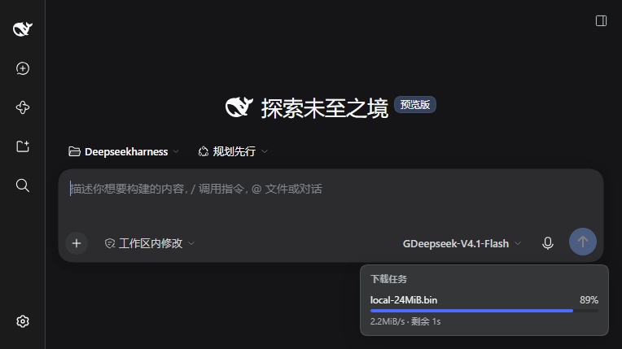

# dsh-smart-dl

[](https://www.npmjs.com/package/@leisureyu/dsh-smart-dl)
[](https://www.npmjs.com/package/@leisureyu/dsh-smart-dl)
[](./LICENSE)
[](https://github.com/LeiSureYu/dsh-smart-download/actions/workflows/publish.yml)


简体中文 · [English](./README.en.md)

> 给 [DeepSeek Harness（DSH）](https://github.com/deepseek-ai)装一个内置 aria2 的下载器:
> 大文件自动多线程、不支持就自动回退 curl、断了能续传、照官方文档核对摘要。
> **Windows / Linux / macOS 六平台完整支持；HarmonyOS（鸿蒙）1.9.1 起可用。**



## 安装

在 DSH 侧边栏 **插件 → 添加插件** 粘贴包名，装完重启 DSH:

```
@leisureyu/dsh-smart-dl
```

命令行（桌面版请用桌面版自带的 CLI）:

```bash
dsh plugin --profile web add @leisureyu/dsh-smart-dl
```

## 快速开始

**基本下载** —— 自动探测、多线程、断点续传:

```jsonc
smart_download({ "url": "https://example.com/tool-1.4.0.zip" })
```

**照官方文档核对** —— 摘要 + 镜像（GitHub 慢时自动选一个被证实同源的镜像）:

```jsonc
smart_download({
  "url": "https://github.com/owner/repo/releases/download/v1.4.0/tool.zip",
  "sha256": "9f86d081884c7d659a2feaa0c55ad015a3bf4f1b2b0b822cd15d6c15b0f00a08",
  "mirror": "auto"
})
```

**一次一批** —— 并发下载、整批限速、单条超时，一条失败不影响其余:

```jsonc
smart_download({
  "targets": [
    { "url": "https://example.com/a.iso", "output": "a.iso" },
    { "url": "https://example.com/b.iso", "sha256": "…" }
  ],
  "maxBandwidth": "4M",
  "timeoutMs": 600000
})
```

**后台执行** —— 立即返回 `taskId`，不占会话，进度面板照常显示:

```jsonc
smart_download({ "url": "https://example.com/big.iso", "background": true })
// 用 download_status(taskId) 查进度;管理器里可取消 / 重试
```

## 功能一览

| 功能 | 用法 |
| --- | --- |
| 多线程加速（按大小 4/8 连接，自动回退 curl） | 默认行为；1.9.0 起走常驻 RPC daemon，暂停/继续为原地语义 |
| 断点续传（同源指纹校验，防「续错文件」） | 默认行为 |
| 摘要校验 | `sha256` 或 `checksum`（MD5 / SHA-1 / SHA-256 / SHA-512） |
| 期望大小核对 | `expectedSize` |
| 镜像加速（自动选择，先证实同源再采用） | `mirror: "auto"` |
| 代理（探测 / 镜像 / 下载三层一致，支持 `NO_PROXY`） | `proxy` |
| 一次下载一批 | `targets` + `maxBandwidth` + `timeoutMs` |
| 暂停 / 继续（半包与指纹保留，从断点续传） | 下载管理器行内按钮 |
| 自动镜像按实测延迟排序（同源校验不变） | `mirror: "auto"` 默认行为 |
| 一键重试全部失败项 | 下载管理器工具栏按钮 |
| 后台执行 | `background: true` |
| 同名文件策略 | `ifExists: "overwrite" \| "skip" \| "rename"` |
| 自定义请求头（凭证走 stdin，不进命令行） | `userAgent` / `referer` / `headers` |
| 服务器文件名 / 磁盘空间预检 | 默认行为 |

## smart_download 参数

| 参数 | 类型 | 说明 |
| --- | --- | --- |
| `url` / `targets` | string / array | **二选一**。批量最多 50 条，逐条结果、部分成功。 |
| `output` | string | 输出路径；缺省依次取 `Content-Disposition`、查询串、URL 末段。 |
| `sha256` / `checksum` | string | 期望摘要。接受裸 hex、`sha256:<hex>`、SRI 等写法；不匹配即失败。 |
| `checksum` | string | 同上，另支持 MD5 / SHA-1 / SHA-512（按长度识别）。与 `sha256` 二选一。 |
| `expectedSize` | integer | 期望字节数（官方文档里印的那个）。与远端声明冲突则发请求前拒绝。 |
| `ifExists` | string | `overwrite`（默认）/ `skip` / `rename`。 |
| `mirror` | string | 镜像前缀（如 `https://gh-proxy.com/`）或 `"auto"` 自动挑选。 |
| `proxy` | string | http(s) 代理地址。探测与下载共用；缺省读 `HTTPS_PROXY` 等环境变量。 |
| `userAgent` / `referer` / `headers` | string / object | 附加请求头，探测与下载共用。 |
| `maxBandwidth` | string | 整次调用的带宽上限，如 `"2M"`、`"500K"`、`"1500000"`。 |
| `timeoutMs` | integer | 单条目超时（1000–1800000ms）。 |
| `background` | boolean | 后台执行，立即返回 `taskId` / 批次 ID。 |

## download_status 参数

| 参数 | 说明 |
| --- | --- |
| `taskId` | 只查某一个任务。 |
| `batchId` | 按批次过滤（后台批量返回的 ID）。 |
| `limit` | 最多返回条数（默认 10）。 |

## 环境变量

| 变量 | 作用 |
| --- | --- |
| `DSH_SMARTDL_MIRRORS` | 覆盖自动镜像候选表（逗号分隔，顺序即优先级）。 |
| `DSH_SMARTDL_ARIA2_PATH` | 显式指定 aria2 二进制路径，优先于随包子包与 PATH（验证失败则回退 curl，不回落其它来源）。 |
| `HTTPS_PROXY` / `HTTP_PROXY` / `ALL_PROXY` | 未传 `proxy` 参数时的代理来源。 |
| `NO_PROXY` | 命中的主机直连（对显式 `proxy` 参数同样生效）。 |
| `DSH_PROGRESS_DIR` / `DSH_DOWNLOAD_PROGRESS_DIR` | 覆盖两条进度轨道的目录。 |

## 支持平台

| 平台 | 架构 | 子包 | 状态 |
| --- | --- | --- | --- |
| Windows | x64 / arm64 | `@leisureyu/dsh-aria2-win32-*` | ✅ 完整支持 |
| Linux | x64 / arm64 | `@leisureyu/dsh-aria2-linux-*` | ✅ 完整支持 |
| macOS | x64 / arm64 | `@leisureyu/dsh-aria2-darwin-*` | ✅ 完整支持（本仓库 CI 从官方源码构建） |
| HarmonyOS | arm64 | `@leisureyu/dsh-aria2-ohos-arm64` | 🟡 1.9.1 起可用；随包子包在路线图上，当前多线程需 PATH 自备 aria2c 或 `DSH_SMARTDL_ARIA2_PATH` |

Windows / Linux / macOS 六个组合均为完整支持（随包 aria2 多线程），安装时包管理器按
`os` / `cpu` 自动只装当前平台的那一个子包。鸿蒙的 OpenHarmony Node 运行时报告
`process.platform === 'ohos'`，与 Linux 二进制不兼容（内核不同，musl 静态二进制
不能复用），因此走独立子包：1.9.1 先落位运行时识别与回退链（开箱 curl 单线程，
PATH 上有 aria2c 则自动多线程），随包二进制将由本仓库 CI 用 OHOS SDK 从官方源码
构建后发布 —— 与 macOS 子包同一信任模型，详见 [COMPATIBILITY.md](./docs/COMPATIBILITY.md)。

## 工作原理

```
smart_download(url, …)
  │ 1. 参数校验(协议白名单/摘要/头/代理/大小)——全部在发请求之前
  │ 2. 探测目标服务器(HEAD → Range GET 兜底,拿长度与 Range 支持)
  │ 3. 大文件且支持 Range → 随包 aria2 多线程(4/8 连接按大小分档)
  │    否则 → curl 单线程;aria2 失败自动回退
  │ 4. 完整性校验:落盘字节数 vs 声明/expectedSize;摘要 vs sha256/checksum
  ▼
返回 { success, path, method, size, … }   进度同时写入两条轨道,面板实时显示
```

所有「跳过 / 回退 / 失败」都会在返回值与进度里**显式写明原因**，绝不静默降级。

## 安全与权限

- 只接受 `http(s)`，协议白名单 + 重定向白名单 + 文件名净化（不可信输入一律挡在下载前）
- 请求头凭证经 **stdin** 传给子进程，不出现在进程命令行；凭证不落盘、重试不重放
- 除「原始 URL（或镜像/代理）」外不访问任何其它地址；无遥测
- 详细威胁模型与五层防护见 [SECURITY.md](./docs/SECURITY.md)

## 兼容性

| 项目 | 要求 |
| --- | --- |
| Node.js | ≥ 22 |
| DSH | 0.2.x 全系（0.1.7-rc.1 起的旧版也支持）；安装/版本要求见 [COMPATIBILITY.md](./docs/COMPATIBILITY.md) |

## 常见问题

- **被 Defender 拦截？** 未签名 `aria2c.exe` 的启发式告警，把项目 `node_modules` 加入白名单即可。
- **下载速度没提升？** 服务器不支持 Range 或文件太小，已自动回退 curl；`reason` 字段写明原因。
- **提示找不到 aria2？** Windows / Linux / macOS 六组合均有子包（镜像源未同步时切官方 npm 源重装）；鸿蒙当前靠 PATH 或 `DSH_SMARTDL_ARIA2_PATH` 自备 aria2c，缺省回退 curl。
- **鸿蒙上怎么开多线程？** 1.9.1 起插件在鸿蒙开箱可用（curl 单线程）。多线程两条路：把自建的 `aria2c` 路径填进 `DSH_SMARTDL_ARIA2_PATH`，或放进 PATH；随包 ohos-arm64 子包在路线图上。
- **GitHub 下载慢？** 传 `mirror: "auto"`。
- **摘要怎么核对？** 把官方文档里的摘要原样传给 `sha256`，四种常见写法都认。
- **重跑报退出码 33 / 36？** 33 = HTTP range error（服务器忽略/未接受你发的 Range），36 = bad download resume（无法从断点续传）。33 不代表服务器永久不支持 Range；删除半包后重跑会全量重下。
- **更多问题** → [TROUBLESHOOTING.md](./docs/TROUBLESHOOTING.md)

## 文档

| 文档 | 内容 |
| --- | --- |
| [CHANGELOG.md](./CHANGELOG.md) | 每个版本的变更记录 |
| [docs/COMPATIBILITY.md](./docs/COMPATIBILITY.md) | 平台 / Node / 包管理器矩阵，macOS 子包的构建与信任模型 |
| [docs/SECURITY.md](./docs/SECURITY.md) | 威胁模型与五层防护 |
| [docs/TROUBLESHOOTING.md](./docs/TROUBLESHOOTING.md) | 症状 → 原因 → 处理 |
| [docs/ARCHITECTURE.md](./docs/ARCHITECTURE.md) | 内部结构与模块职责 |

## 开发

```bash
pnpm install
pnpm test        # node:test,不依赖真实网络
pnpm build       # 输出 dist/
pnpm check       # 类型检查
```

推送 `v*` tag 即触发发布:三个平台的二进制 job（macOS 从官方源码自构建，附 SLSA provenance）→ 测试 → 先发子包、再发主包。

## 第三方组件与许可

- 本插件代码：MIT
- 随包分发的 aria2 1.37.0：GPL-2.0-or-later。来源:Windows x64 取官方发布包，Linux 取 [abcfy2/aria2-static-build](https://github.com/abcfy2/aria2-static-build)，Windows arm64 取 [minnyres/aria2-windows-arm64](https://github.com/minnyres/aria2-windows-arm64)，macOS 由本仓库 CI 从官方源码构建（来源与哈希见 [COMPATIBILITY.md](./docs/COMPATIBILITY.md)）。

## 声明

本项目为**社区维护的第三方插件**，非官方项目，与 DeepSeek AI 及其关联公司无隶属关系，也未获其背书或赞助。插件名称中的 "dsh" 仅用于说明兼容性。
