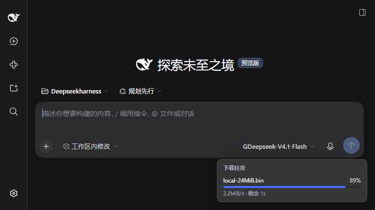

# dsh-smart-dl

[](https://www.npmjs.com/package/@leisureyu/dsh-smart-dl)
[](https://www.npmjs.com/package/@leisureyu/dsh-smart-dl)
[](https://www.npmjs.com/package/@leisureyu/dsh-smart-dl)
[](https://github.com/LeiSureYu/dsh-smart-download/actions/workflows/publish.yml)

[](https://dsh-plugin.org/plugins/leisureyu/dsh-smart-download)

**简体中文** · [English](./README.en.md)

> **给 DSH 装上一个内置 aria2 的下载器。** 一条命令装好，不用自己配环境：大文件自动多线程加速，服务器不支持就自动回退，中途断了还能续传。



```bash
dsh plugin --profile web add @leisureyu/dsh-smart-dl
```

桌面版（DeepSeek Harness 0.2.0 起）装同一个包：用桌面版自带的 CLI，或侧边栏的 Plugins 页面。

- **自动多线程加速** —— 下载前先探测目标服务器，支持多连接就调用内置 `aria2c` 并发下载，不支持则自动回退到系统 `curl`，两种情况都能下完。
- **零配置** —— aria2 二进制随插件一起安装（npm `optionalDependencies`），无需自行下载或配置 PATH。
- **进度看得见** —— 带 Web 界面的 profile（`web` / 桌面版）右下角有实时进度面板（文件名 / 百分比 / 速度 / 剩余时间），下载完成后自动消失。
- **断点续传** —— 中断后用同样的 `url` + `output` 再调用一次即可续传。
- **进度可查询** —— `download_status` 工具只读查询最近任务的百分比 / 速度 / ETA。
- **一次下一批** —— `targets` 在单次调用内下载多个文件（逐条给出结果、一条失败不影响其余、批内并发受「总连接数有界」约束），`maxBandwidth` 给整批一个共享的带宽上限，`timeoutMs` 给每个条目一个超时。见[批量下载](#一次下载多个文件targets--maxbandwidth--timeoutms)。
- **照官方文档核对内容** —— 把官方文档里印着的 SHA-256 传给 `sha256`，下载后逐字节核对。长度校验挡不住「等长但内容不同」，哈希能。
- **能带请求头** —— `userAgent` / `referer` / `headers`：官方文档给的地址常需要伪装浏览器或带 Referer，探测与下载用**同一套**头，不会两边不一致。
- **镜像自动挑** —— `mirror: "auto"` 时插件自己从内置候选表里选一个**被证实与原地址同源**的 GitHub 镜像，模型不用先「知道」gh-proxy 这类域名。

支持 **Windows x64 / arm64** 与 **Linux x64 / arm64**，这四组合是完整支持（随包 aria2 多线程）。
macOS 能装能用，但永远走 `curl` 单线程 —— 原因见[兼容性说明](./docs/COMPATIBILITY.md)，那里写清了每个来源逐个核对后为何仍不成立（卡点是「来源不可信」，不是「没有二进制」），也写清了为什么没硬做。

`dsh-smart-dl` 为 [DeepSeek Harness（DSH）](https://github.com/deepseek-ai) 注册两个工具：

- **`smart_download`**：下载文件。先探测目标服务器是否支持多线程，支持则调用随插件分发的 `aria2c` 多线程加速，否则自动回退到系统自带的 `curl` 单线程下载，保证任何情况下都能完成下载。可选：`mirror` 镜像加速（前缀或 `auto`）、`sha256` 内容核对、`userAgent` / `referer` / `headers` 请求头、断点续传；用 `targets` 代替 `url` 可一次下载一批（`maxBandwidth` 限整批带宽、`timeoutMs` 限每个条目的耗时）。
- **`download_status`**：查询下载进度。只读地返回最近任务的状态快照（百分比、速度、ETA），可用来回答“刚才那个下载到百分之几了”。

## 安装

```bash
dsh plugin --profile web add @leisureyu/dsh-smart-dl
```

安装后无需任何额外配置：aria2 二进制通过 npm 的 `optionalDependencies` 机制随插件一起安装。

**支持的 profile**：`web` 与 `desktop`（0.2.0 起的桌面版）。安装命令形如 `dsh plugin --profile <profile> add <包名>`，请把 `<profile>` 换成你实际使用的 profile 名称。

**桌面版请用桌面版自带的 CLI 安装**，不要用系统里另外装的 `dsh`（桌面版的 profile 由 Electron 应用独占管理）：

```powershell
& "$env:LOCALAPPDATA\Programs\DeepSeek Harness\resources\runtime\cli\bin\dsh.cmd" plugin --profile desktop add @leisureyu/dsh-smart-dl
```

也可以在桌面版侧边栏的 Plugins 页面里添加。

### 从 Git 仓库地址安装

除了 npm 包名，也可以直接填仓库地址：

```bash
dsh plugin --profile web add https://github.com/LeiSureYu/dsh-smart-download
```

要求与注意事项：

- 地址必须是 `https://<host>/<owner>/<repo>` 这种三段形态（可带 `.git` 后缀或 `#<ref>`）。带路径前缀的代理镜像地址（如 `https://ghfast.top/https://github.com/owner/repo.git`）**不被接受**。
- git / tarball 安装是**直接抓取仓库内容**：`dist/` 已提交进仓库，无需本地构建、不跑 `prepare`、`allowBuilds` 审批也无关。从 git 安装时 `files` 字段仍然生效，未列入的源码不会被装进去。
- 兼容性（`peerDependencies`）在抓取之后才判定，不匹配会回滚 profile 文件，不会留下半装状态。
- DSH 在安装前会用 `git ls-remote` 探测 **GitHub** 主机，超时 5 秒即判失败。如果你所在的网络访问不了 `github.com`，这一步就会失败 —— 请改用 npm 包名 `@leisureyu/dsh-smart-dl`（推荐）或插件市场安装。

> **进度面板只在带 Web 界面的 profile 生效**（`web` 与桌面版的 `desktop`）。纯 CLI 等 profile 下插件功能完全不受影响，只是没有界面面板，仍可用 `download_status` 工具查询进度。

> **1.2.0 加了「照着官方文档把文件下对」的三件工具**：`sha256` 内容核对、
> `userAgent` / `referer` / `headers` 请求头、`mirror: "auto"` 自动挑镜像；并修掉三处
> 探测与回退缺陷（HEAD 失败不再直接放弃探测、HEAD 分支漏读 `Content-Range` 会把
> 正确下载判成损坏、完整性校验失败不再白跑一遍 curl）。逐条依据见 [CHANGELOG.md](./CHANGELOG.md)。
>
> **1.1.0 为 DSH 0.2.0 适配。** 0.2.0 起安装前会核对 `peerDependencies`：`0.4.0` 及更早版本声明的范围不含 `0.2.0`，装上后整个 bundle 会被跳过，插件完全不加载。如果你装的是 `0.4.0` 或更早，升级即可；`0.4.1` 起已覆盖 0.2.0。详见 [COMPATIBILITY.md](./docs/COMPATIBILITY.md)。
>
> **1.0.0 是首个正式版。** 相较于 0.9.x，这一版把「哪些情况在静默降级」全部摊开：完整性校验的**跳过**与**通过**不再共用同一个返回值（新增 `verifySkipped` 字段），取消下载会真的上报 `cancelled` 而不是伪装成失败，并且修掉了两个 0.9.0 遗留的真问题 —— `mirror` 参数可以绕过协议白名单（`file://` 前缀会把本地文件复制出来），以及 `awaitFlush` 的超时计时器没 `unref` 导致 CLI 每次下载多卡约 2 秒。逐条依据见 [REVIEW-1.0.md](./docs/REVIEW-1.0.md)。
>
> **版本要求：请使用 `1.2.0` 或更高。** 0.7.0 ~ 0.9.0 的历史（完整性校验、续传指纹、进度轨道 `state`、面板、跨平台二进制）不再在这里复述，完整记录见 [CHANGELOG.md](./CHANGELOG.md)。
>
> 更早的 `0.1.x` / `0.2.1` 有安装期缺陷（插件清单校验、`peerDependencies` 范围解析不到预发布版），不要再用；升级到 `1.2.0` 即可。

## 照着官方文档下载

大多数「按官方文档装东西」的场景都能落成一次 `smart_download` 调用：文档给你
**地址**，通常还给你**摘要**，有时还需要**请求头**。三样东西对应三个参数。

```
文档里写什么                          传给 smart_download 的哪个参数
─────────────────────────────────────────────────────────────────────
https://example.com/tool-1.4.0.zip   url（必填）
SHA256: 9f86d081884c7d65…             sha256（可选，但强烈建议）
「需要 Referer / 请用浏览器 UA」        referer / userAgent
「国内请用 GitHub 加速」                mirror: "auto"（GitHub 地址）
「装到某个目录」                        output
```

一个照抄即可的调用：

```
smart_download(
  url:    "https://github.com/owner/repo/releases/download/v1.4.0/tool.zip",
  sha256: "9f86d081884c7d659a2feaa0c55ad015a3bf4f1b2b0b822cd15d6c15b0f00a08",
  mirror: "auto"
)
```

> 这个单条目形态**不传新参数时**与 1.2.0 逐字段相同；`timeoutMs` 与 `maxBandwidth` 对单条目调用同样有效（`timeoutMs` 是**每个条目**的超时，不是批量专属），实测传了但未超时时返回结构的键集合也不变。详见[批量下载](#一次下载多个文件targets--maxbandwidth--timeoutms)。

得到的结果会明确告诉你这次到底做了什么：

```json
{
  "success": true,
  "path": "tool.zip",
  "method": "aria2",
  "size": 52428800,
  "fellback": false,
  "reason": "支持 Range，文件 50.0MB，使用 8 连接",
  "sha256": "9f86d081884c7d659a2feaa0c55ad015a3bf4f1b2b0b822cd15d6c15b0f00a08",
  "requestedUrl": "https://gh-proxy.com/https://github.com/owner/repo/releases/download/v1.4.0/tool.zip",
  "mirrored": true,
  "mirror": "https://gh-proxy.com/"
}
```

### `sha256`：把文档里的摘要粘进来

接受官方文档里常见的各种写法，都会归一化成同一个小写十六进制：

| 文档里的写法 | 是否接受 |
| --- | --- |
| `9f86d081884c7d65…`（裸十六进制，大小写均可） | ✅ |
| `sha256:9f86d081…` / `sha256=9f86d081…` / `SHA256(9f86d081…)` | ✅ |
| `sha256-<base64>`（网页 `integrity` 属性里的 SRI 形式） | ✅ |
| 长度不是 64 位、含非十六进制字符、`md5:` / `sha1:` 前缀 | ❌ 下载前直接拒绝 |

要点：

- **不合法会在下载开始前就拒绝** —— 不会白下几百 MB 之后才告诉你参数写错了。
- **核对失败一律判失败**：抛错、不返回 `success`，并保留旁车指纹（下次才有得比）。
- **它不依赖任何远端信息**，所以在「远端未声明长度」或「远端声明了压缩编码」导致
  长度校验跳过时，它依然能给出确定结论；此时返回值里**不会**出现 `verifySkipped`
  —— 内容已经逐字节核对过，再报「未做字节数校验」只会误导。证明由 `sha256` 字段承载。
- **流式计算**：几百 MB 的安装包不会整份读进内存。

### `userAgent` / `referer` / `headers`：地址不是直接 GET 就能拿到时

三者合成**一份**头表，**探测与下载共用同一份**。这一点是刻意的：两边不一致时，
按 UA 分流的站点会让探测拿到 200、下载拿到 403，或者返回体积不同的响应 ——
前者让决策基于一个下载时根本不成立的响应，后者让大小校验 100% 误报。

```
smart_download(
  url:       "https://example.com/gated/model.bin",
  userAgent: "Mozilla/5.0 (Windows NT 10.0; Win64; x64)",
  referer:   "https://example.com/downloads",
  headers:   { "Authorization": "Bearer <token>" }
)
```

边界：

- **插件自身管理的头不允许覆盖**：`Range`、`Accept-Encoding`、`Content-Length`、
  `Host` 与连接级头（`Connection` / `Transfer-Encoding` / `Keep-Alive` / `TE` /
  `Trailer` / `Upgrade` / `Proxy-*`）。它们各自承载着探测 / 续传 / 校验的既有语义，
  被覆盖会静默改变行为。
- **头值含 CR / LF / NUL 一律拒绝** —— 那是请求头注入，可以让调用方凭空往请求里
  塞新头甚至新请求。
- 命名参数优先于 `headers` 里的同名项；同名头（不分大小写）只保留一条。
- 上限：32 条头、头名 128 字符、头值 8192 字符。

### `mirror: "auto"`：文档只给原始 GitHub 地址时

官方文档给的永远是**原始地址**，而能不能连上取决于你所在的网络。传 `mirror: "auto"`
即由插件自己挑：

1. 只对 GitHub 域名生效（`github.com` / `raw.githubusercontent.com` / `codeload.github.com`
   / `objects.githubusercontent.com` 等），其它地址会明确回一句 `mirrorSkipped` 说明；
2. 候选表内置（见下方「镜像加速」），也**可以用 `DSH_SMARTDL_MIRRORS` 换成你自己的**；
3. 候选必须**被证实与原地址同源**才会被采用：文件长度完全一致，且原始地址给了
   `ETag` 时，候选也必须给出相等的 `ETag`（归一化后比较，`W/` 弱校验前缀不影响判定）；
4. 一个都没证实，就退回原始地址下载，并在返回值里写明 `mirrorSkipped` 的原因。

> **自动镜像必须显式传入才会生效。** 它会让下载内容经过第三方服务器，这是调用方
> （而不是插件）该做的决定，所以不设默认值。
>
> **这道「同源证明」防的是无心之失，不是投毒。** `ETag` 是镜像**自己声明的**，一个
> 恶意镜像可以照抄原始 ETag 再返回等长但不同的内容 —— 长度与 ETag 都对得上，字节数
> 校验也拦不住。要防投毒只有 `sha256`：摘要来自官方文档，镜像伪造不了。


## 工作原理

下载决策流程（文字版）：

```
调用 smart_download(url, output?, mirror?, sha256?, userAgent?, referer?, headers?)
        │
        ▼
[0] 参数前置校验（都在**下载开始前**，不合法直接拒绝）
     · url 必须是 http(s)（file:// / ftp:// 一律拒绝）
     · sha256 必须能归一化成 64 位十六进制
     · headers 不能覆盖插件自管的头，值不能含 CR / LF / NUL
        │
        ▼
[1] 组装请求头：headers + userAgent + referer 合成**一份**，
    探测与下载共用（两边不一致会让探测结论与真实下载错位）
        │
        ▼
[2] 镜像解析
     · 显式前缀：镜像前缀 + 完整原始 URL
     · "auto"：先探测原始地址，再逐个探测内置候选，
       只采用「长度一致，且原始有 ETag 时 ETag 也一致」的候选；
       一个都没证实就退回原始地址并写明 mirrorSkipped
     · 非 http(s) URL 不走镜像；输出文件名始终按原始 URL 推导
        │
        ▼
[3] 探测 URL（超时 5s）
     · 先发送 HEAD 请求
     · HEAD 抛异常（超时 / 被墙）、返回 405、或缺少 Content-Length，
       都改用 GET + "Range: bytes=0-0" 兜底再判一次
     · 两条路都失败才判「不支持多线程」
        │
        ▼
[4] decide() 按文件大小与 aria2 可用性分档：
     · 不支持 Range / 探测失败 / 无法获取大小 / <1MB  -> curl
     · 1MB ~ 8MB   -> aria2 4 连接
     · ≥ 8MB        -> aria2 8 连接（保守上限，不开 16）
        │
   ┌────┴──────────────────────────┐
   ▼ aria2 档                       ▼ curl 档
[5a] 能定位到随包 aria2c？         [5b] curl 单线程（含进度条）
   │ 是              │ 否
   ▼                 ▼
  aria2 4/8 连接     curl 单线程（回退）
  （每秒摘要进度）
  （能证实同源时 -c）  （能证实同源时 -C -）
    │ 失败
    ▼
  降级为 curl 单线程（回退）
  注：完整性校验失败**不**走这条回退 —— 产物内容不对，
      换下载器重下同一地址不会改变结果
        │
        ▼
[6] 完整性校验（两层，各自独立）
     · 落盘字节数 vs 远端声明长度（verifySize）
     · 调用方给的 SHA-256 vs 实际算出的摘要（verifySha256）
        │ 通过                │ 失败
        ▼                     ▼
   清除 .part.json       抛错，保留旁车
   返回 success

  返回结果 { success, path, method, size, fellback, reason?, verifySkipped?,
            sha256?, requestedUrl, mirrored, mirror?, mirrorSkipped? }
```

要点：

- **探测异常不会让下载失败，但「HEAD 抛异常」不再等于「不支持多线程」**：HEAD 超时 / 被墙时会
  改用 Range GET 兜底再判一次（1.2.0 修正）。此前 HEAD 一失败就宣告「不支持且大小未知」，
  连带白等一整个探测超时、完整性校验永久退化成「跳过」、大文件也永远单线程。
  两条路都失败才回退 curl，`reason` 会同时写明两条失败原因。
- 并发数随文件大小动态选择（阈值 1MB / 8MB），`reason` 会区分“不支持 Range”“文件太小”“aria2 缺失”等情况。
  阈值是 0.7.0 实测定下的，不是拍脑袋（见下方「并发阈值是实测的，不是猜的」）。
- **下载完成后会校验落盘字节数**：`curl` / `aria2` 的退出码 0 只代表“它自己认为完成了”，不代表字节数对。
  少发、多发、镜像返回 200 的错误页等场景都不会有非零退出码，只有校验能拦下（详见「设计上的静默失败防护」）。
- **传了 `sha256` 就再核对内容**：长度校验挡不住「等长但内容不同」，哈希能，而且它不依赖远端信息，
  在长度校验被迫跳过时依然给出确定结论。
- 返回的 `requestedUrl` 是**实际请求的地址**（启用镜像时为「镜像前缀 + 原始 URL」），`mirrored` 标明本次是否走了镜像，
  `mirror` 是实际用的前缀，`mirrorSkipped` 说明「请求了自动镜像但没用上」的原因。
- **只允许 `http` / `https`**：URL 来自模型读到的任意页面，属于不可信输入。其他协议（`file:`、`ftp:` 等）在下载开始前直接被拒绝，不会进入探测或下载流程。
- **不支持 FTP / SFTP / BitTorrent**：协议白名单只放行 `http` / `https`。放开之后五层防护里只剩第五层（调用方给的 `sha256`）有效，而它是**可选参数** —— 也就是说默认情况下 FTP 下载没有任何内容校验；BitTorrent 更进不来（DHT / 监听端口 / 做种会打破「除原始 URL 外不访问其他地址」这条权限承诺）。逐条依据（2026-10-12 核对）见 [PLAN-P2-PLATFORM.md](./docs/PLAN-P2-PLATFORM.md) §B。
- **输出文件名会被净化**：未传 `output` 时按 URL 推导文件名，推导结果只取**单个路径段**——URI 解码后的 `/`、`\`、`..` 等一律丢弃，因此不会写到工作目录之外。

### 为什么必须做协议白名单与文件名净化（实测结论，勿移除）

> `0.4.1` 实测：`file:///C:/Windows/win.ini` 会被 `curl` 接受并**成功复制本地文件**到目标路径；
> `http://host/..%2F..%2F..%2Fescaped.txt` 会解码出 `../../../escaped.txt`，未指定 `output` 时
> 文件被写到**当前工作目录之外**（实测确认写入成功）。两者都在 `0.4.2` 修复：前者由协议白名单
> 拦截，后者由「解码后再切分、只取最后一段 + 净化」拦截。

## 镜像加速

下载 GitHub Release 等境外资源较慢时，可给 `smart_download` 传入 `mirror` 前缀，插件会把原始 URL 拼到该前缀后面再下载：

```
smart_download(
  url: "https://github.com/owner/repo/releases/download/v1/a.zip",
  mirror: "https://gh-proxy.com/"
)
# 实际请求：https://gh-proxy.com/https://github.com/owner/repo/releases/download/v1/a.zip
```

细节：

- 只做**前缀拼接**，不做路径改写，因此适配绝大多数「前缀 + 完整原始 URL」形式的公开镜像；
- 前缀**缺尾斜杠会自动补上**，也可直接写裸域名（`ghfast.top` 会补成 `https://ghfast.top/`）；
- 非 `http(s)` 的 URL 不使用镜像；**镜像前缀本身也必须过白名单** —— 非 `http(s)` 的前缀（`file://`、`javascript://`、`data://` 等）一律不生效、原样走原始 URL。字符串拼接后整串的 scheme 由前缀决定，不判前缀就等于给 `file://` 开了后门（1.0.0 修正，实测见 [SECURITY.md](./docs/SECURITY.md)）；
- 输出文件名始终按**原始 URL** 推导，不会把镜像域名带进文件名。

### 不想手填前缀：`mirror: "auto"`

传字面量 `auto`，由插件从候选表里挑一个**被证实与原地址同源**的镜像。
完整规则与安全边界见上方[「照着官方文档下载」](#mirror-auto文档只给原始github-地址时)一节。

### 换成自己的镜像：`DSH_SMARTDL_MIRRORS`

内置候选是三个**公开第三方**服务，企业内网 / 自建代理的场景下一个都用不了。
用逗号分隔的前缀表覆盖它，**顺序即优先级**：

```bash
# Linux / macOS
export DSH_SMARTDL_MIRRORS="https://my-mirror.corp/ , http://10.0.0.9:8080"

# Windows PowerShell
$env:DSH_SMARTDL_MIRRORS = "https://my-mirror.corp/,http://10.0.0.9:8080"
```

空 / 纯空白 / 只有逗号都视为未设置，回落内置表。改动不影响「同源证明」：
自定义镜像同样必须通过长度 + ETag 的核对才会被采用。

常见的公开镜像（任选其一，可用性随网络环境变化）：

| 镜像前缀 |
| --- |
| `https://gh-proxy.com/` |
| `https://ghfast.top/` |
| `https://ghproxy.net/` |

> 镜像是**第三方服务**：请求内容会经过该镜像服务器，请勿用它下载含敏感信息的文件。

## 断点续传

下载中断后再次调用 `smart_download`（同样的 `url` 与 `output`）会从断点继续，而不是从头重下：

- **aria2 路径**：能证实同源时启用 `-c`，否则不续传并带 `--allow-overwrite=true` 覆盖写。
- **curl 路径**：**仅在探测确认服务器支持 Range 且能证实同源时**才加 `-C -`。

为什么续传除了「支持 Range」还要多一道校验（实测结论，勿简化）：

> `0.6.0` 用真实 curl 8.13.0 与随包 aria2 1.37.0 在 127.0.0.1 上实测：远端从 400 字节变成 200 字节时，`curl -C -` 与 `aria2 -c` 都是**退出码 0、落盘仍是 400 字节**；远端等长但内容换了时，两者同样是**退出码 0、文件保留旧内容**。也就是说「支持 Range」只保证能续，不保证续的是同一个文件。
> 因此续传前会比对远端长度与 `ETag` / `Last-Modified`（指纹记在 `<output>.part.json` 旁车里，下载成功时清除、中断时保留），无法证实同源就删掉本地半包全量重下。只比长度挡得住前两行，挡不住「等长但内容变了」，这也是必须有旁车指纹的原因。

为什么 curl 的续传是条件式的（实测结论，勿改成无条件）：

> 先按官方定义对齐两个相邻的退出码：curl **33 = HTTP range error**（我们发出的 Range 请求未被服务器接受），而「服务器不支持续传」在 curl 里对应的是 **36 = bad download resume** —— 两者不是一回事，此前这里把 33 直接解释成「服务器不支持 Range」是不准确的。
> 本机实测（curl 8.13.0）：服务器**忽略**我们发的 `Range`、且本地已存在半截文件时，`curl -C -` 会以**退出码 33 直接失败**——1000 字节资源、已有 400 字节半包 → `exit 33`，文件保持 400 字节不损坏；而同一场景**不带** `-C -` 能正常全量重新下载成功。也就是说：33 也可能意味着「服务器忽略了你发的 Range」，这与官方定义（range error）是同一件事的两种说法，但**不能**据此推断服务器永久不支持续传（那要按 36 判）。
> 支持 Range 时三种情况均实测正确：半包续传、已下载完整后重跑、文件不存在从头下。

## 一次下载多个文件：`targets` / `maxBandwidth` / `timeoutMs`

`url` 下载单个文件；`targets` 在**一次调用内**下载一批（P0 的核心交付）：

```json
{
  "targets": [
    { "url": "https://example.com/a.iso", "output": "a.iso" },
    { "url": "https://example.com/b.iso", "output": "b.iso", "sha256": "<官方文档里的摘要>" }
  ],
  "maxBandwidth": "4M",
  "timeoutMs": 600000
}
```

### 二选一与上限

- **`url` 与 `targets` 二选一**：两个都给、或两个都不给，都在**发起任何请求之前**被拒绝 —— 不会「以某一个为准」，静默忽略一边会让调用方以为两边都下了。因此 `url` **不是**必填参数。（这条约束在工具 schema 层表达不出来：参数表的根节点只能是一张属性表，放不下「二选一」，所以由执行层强制并在参数说明里写明后果。）
- **`targets` 是空数组**同样在发起请求之前被拒绝。
- **单批上限 50 条**，与 `download_status` 的读取上限对齐。超限**显式拒绝**并回报实际条数，而不是截断 —— 静默丢掉尾巴会变成「下过了但查不到」，那种现象无从解释。需要更多就拆成多批。
- 每条可以带自己的 `output` 与 `sha256`；`mirror` / `userAgent` / `referer` / `headers` / `maxBandwidth` / `timeoutMs` 是**整批共享**的。
- **同步返回**：整批跑完才返回（不是「提交任务、稍后查」）。正因如此，`timeoutMs` 才有存在的必要（见下）。

### 逐条结果与「部分成功」

批量返回 `batch`（批次 ID）、`succeeded` / `failed` / `cancelled` 三个计数，以及逐条的 `results[]`（`succeeded + failed + cancelled === results.length`）：

- **一条失败不影响其余条目**：每一行都有自己的 `success`、落盘 `path`（失败时也给出「本该落到哪」）与 `error` 原因。为什么逐条给而不是只报计数：只给「N 条成功 M 条失败」，调用方仍然不知道要不要重试、重试哪一条。
- **失败与取消分开计数**（与单条目路径同一条规则）：`failed` 是「下载坏了」，`cancelled` 是「整批被取消」，二者在面板上是两个状态。整批取消时，还没开工的条目也会各留一条 `cancelled` 记录，不会凭空消失。
- 失败文案沿用单条目那套（例如 `aria2c 退出码 22：…`），**不含**可执行文件的绝对路径。
- 每个条目的进度记录都带同一个 `batch` ID：`download_status` 与面板都能把一次调用的条目归到一起。

### 批内并发：按「总连接数有界」反推

批内用滑动窗口并发（不是「固定分成几组」：组里最慢的一条会拖住整组，而各条目耗时天然差很多）。窗口宽度**不是**单条目的最高档 8 —— 那会让峰值连接数达到 8 × 8 = 64，直接违背「单文件上限压在 8 是为了避免触发服务器按 IP 限并发」这个既定取舍。现在的规则是：

```
批内连接预算 = 单条目最高档 × 2      （= 16；两倍是愿意为「批量比单文件快」多冒的连接风险上限）
窗口         = 预算 ÷ 单条目可能占用的连接数
```

代入当前档位（小文件 4 连接 / 大文件 8 连接）：每条 8 连接时窗口 2、每条 4 连接时窗口 4，两种情况峰值都在 16 附近。批量在开工前不知道各条目的大小（那要逐条探测），因此统一按最高档保守计算 —— 当前实际窗口恒为 2。单条目内部开 4 还是 8 仍按文件大小决定。

### `maxBandwidth`：整批共享的带宽上限

接受裸字节数或 K/M/G 后缀（1024 进制），如 `"4M"`、`"500K"`、`"1500000"`。它是**一次调用**的上限，不是每条的上限：批量时按实际并发位均分（`"4M"` + 窗口 2 → 每条 2M），因此一次调用的合计吞吐不会超过它。落到子进程上是 aria2 的 `--max-overall-download-limit` 与 curl 的 `--limit-rate`。**非法值在发起任何请求之前抛错** —— 交给子进程等于「用户以为限了速，其实没限」（它们对非法参数是静默忽略的）。

### `timeoutMs`：单条目超时（路线 A 是同步调用）

`timeoutMs` 是**每个条目**的超时（毫秒，`1000`..`1800000`，即 1 秒到 30 分钟）。为什么需要它：本工具是同步调用，一个卡死的条目会让整批一直不返回。30 分钟是保守上限（1GB @ 1MB/s ≈ 17 分钟），更长的等待说明应当改用「先返回、后台继续」的形态 —— 那个形态明确不做，所以宁可让它在这里失败，也不挂住整个会话。

超时之后会发生什么（这几条是定义，不是实现细节）：

- **超时的那一条记 `failed`**，不是 `cancelled` —— 用户并没有按取消，两者在面板上是两个状态。`results[]` 里那一行的 `error` 与两张进度轨道上的终态都写明「下载超时：<毫秒>ms 内没有完成（已终止这一条；半包与旁车指纹保留，重跑会先核对同源再续传）」。
- **批量里其余条目继续跑**：超时只终止它自己那一条的子进程（探测、aria2、curl 三个阶段都算）。
- **已完成条目的结果不会被改判**：已经在 `succeeded` 里的条目及其 `path` 原样保留。
- 超时**不**回退到 curl —— 回退等于把同一份等待再花一遍。
- 缺省（不传）表示不设超时；非法值（越界、小数、非数字）在发起任何请求之前抛错。

## 查询下载进度：download_status

`download_status` 只读地返回本插件下载任务的状态快照，可用来回答“刚才那个下载到百分之几了”。

```
download_status()                      # 列出最近 10 个任务
download_status(limit: 3)              # 只列最近 3 个
download_status(taskId: "dl-xxx")      # 只查指定任务
```

返回示例：

```json
{
  "ok": true,
  "taskDir": "/path/.dsh-progress/<session-id>",
  "downloadDir": "/home/u/.dsh/downloads/tasks",
  "total": 1,
  "tasks": [
    {
      "id": "dl-mulfpr76-z47a",
      "name": "local-24MiB.bin",
      "pct": 100,
      "msg": "下载完成",
      "status": "completed",
      "spd": "8.2MB/s",
      "eta": "",
      "updatedAt": 1759000000000
    }
  ]
}
```

约束与设计取舍：

- **纯只读**：不写文件、不联网。读取的就是「进度上报」那一节里的两条轨道目录。
- **容错优先**：目录不存在、权限不足、文件内容损坏，都退化为「该任务不出现在结果里」，整个调用依然成功返回（只是任务列表更短），不会因为查状态而让下载失败。
- 任务按 `updatedAt` **倒序**，最新的排在最前；`total` 是**未截断**的真实总数，`tasks` 会被 `limit` 截断。
- `name` 是输出文件名（面板与列表显示用），未知时回退为任务 ID。
- `spd` / `eta` 在不支持或未知时返回**空字符串**（schema 要求 string），不会返回 `null` 或 `undefined`。

## 进度上报

下载过程中通过 `ProgressReporter` **双轨**写入进度，任一轨道不可写都静默容错，不影响下载：

- 轨道一（dsh-task-progress 格式）：`$DSH_PROGRESS_DIR/<taskId>.jsonl`，每行一条 JSON，append-only。**DSH 0.2.0 起官方不再内置这个读取端**，只有第三方插件 [`dsh-task-progress`](https://www.npmjs.com/package/dsh-task-progress) 会读；轨道二与内置面板不受影响。未设置该环境变量时，缺省为 `<session.cwd>/.dsh-progress/<session.id>/<taskId>.jsonl`（会话 ID 与工作目录来自 `exec.agent.session.header`）。**拿不到会话上下文时不写轨道一**——dsh-task-progress 的读取端按 session 过滤，写进错误的目录等于没写；
- 轨道二（本插件自有格式）：`$DSH_DOWNLOAD_PROGRESS_DIR/<taskId>.json`，缺省为 `<DSH_HOME>/downloads/tasks/<taskId>.json`（`DSH_HOME` 缺省为 `~/.dsh`），整体覆盖写。

每条记录都带 `state` 字段（`running` / `done` / `failed` / `cancelled`）：dsh-task-progress 的读取端只认 `state`，缺失时一律当作 `running`，因此 0.5.0 之前的进度记录即使 `pct=100`、`msg=下载完成`，面板也永远显示「下载中」。进度**按整条记录去重**（`pct + state + msg + spd + eta` 完全一致才跳过），任一项变化都会写入，因此面板能看到实时的速度与剩余时间；完成 / 失败 / 取消等终态因为 `state` 变化，必然穿透去重。aria2 解析 `--summary-interval=1` 的摘要行（含速度与 ETA），curl 解析 `--progress-bar` 的百分比。

写盘自 `0.6.0` 起是**异步**的：`report()` 只把记录放进队列，由 microtask 批量写出并保序，下载主流程不再被同步 `appendFileSync` 阻塞；调用方在返回前会 `await reporter.awaitFlush()` 等待终态落盘，因此 `download_status` 与面板读到的必定是终态，而不是上一次的中间状态。

## 界面进度面板（web / desktop）

在带 Web 界面的 profile（`web`，以及桌面版的 `desktop`）下，插件会在界面右下角挂载一个**实时进度面板**：只要有下载在进行就自动出现，显示**输出文件名、百分比、传输速度与剩余时间**；下载完成后短暂显示「已完成」回执，然后自动消失。空闲时不占位、不显示。


实现要点（如遇面板不显示，可据此排查）：

- **走宿主 RPC**：客户端通过 `connection.fetch.register` 注册的 `/api/smartdl.status` 拉取进度快照，与 `download_status` 工具读的是同一份进度文件。
- **插槽**：注册到 `shell.overlay`（`kind: 'list'`，`order: 100`），因此不会覆盖宿主自身界面；无内容时渲染为 `null`。
- **只依赖 `react`**：客户端脚本以 classic script 形式通过 `window.__ModuleLoader__.load` 注册，不做打包。
- **陈旧任务自动忽略**：超过 10 分钟没有更新的 `running` 任务不再计入面板，避免历史残留文件让面板永久卡住。
- **面板是只读的（本轮明确不提供取消 / 重试）**：面板侧没有任何能触发宿主动作的 API —— 客户端插件只拿到 `connection.rpc.call`（一次请求一个响应），没有「让宿主去做某件事」的通道；宿主侧也没有 `taskId → AbortController` 表：那次下载的 `AbortSignal` 只活在 `execute()` 的调用栈里，RPC 处理函数够不到它。因此本轮不加任何「点了没反应」的按钮；要做取消/重试，先得扩建 RPC 写端点、进程内任务注册表与任务元数据（原 URL / 输出路径 / 摘要）。

> 该面板仅在带 Web 界面的 profile 提供；CLI 等 profile 下插件会静默跳过客户端注册，工具与下载功能不受影响。

## 下载管理器（1.4.0 起）

左侧边栏新增「**下载管理**」入口，点开是**占满主区的一页列表**：能看到**全部任务**（进行中 + 已完成，含失败与取消），
不再受浮层 30 秒回执期的限制。

**列表能力**：按状态筛选（全部 / 下载中 / 已完成 / 失败·取消，各带计数）、按文件名搜索（大小写不敏感）、
多选后批量删除记录。批量**只删记录，绝不删本地文件** —— 一次误选就是多个文件永久消失（不进回收站），
代价不对称；要删文件就逐行进确认框。

**每行显示**：状态色点 + 彩色状态文字、进度条（按状态着色）、文件名与百分比、大小、最近更新时间，
以及 `presence` 徽标（文件在原位 / 已移走 / 已改变 / 路径不可删）；**下载中另有实时速度与剩余时间**
（ETA 只在下载中显示 —— 给已完成的任务报「剩余 0s」是噪声）。行内两个操作：

- **在文件夹中显示**：打开系统文件管理器并**选中那个文件**。优先走宿主的 `remote.session`；该服务不可用时
  **自动降级到服务端**（宿主进程执行 `explorer.exe /select,` / `open -R` / `xdg-open`），因此**不依赖任何
  客户端注入**，对工作区之外的路径同样可用 —— 下载文件通常不在工作区里。
- **删除**：二次确认框会显示**完整绝对路径、文件大小**，并明写「**删除本地文件不可恢复，不进回收站**」。
  「**同时删除本地文件**」只在文件仍在原位时提供；**文件已被移走、或与下载完成时不一致（大小/修改时间变了）时，
  只能删除记录** —— 这是「删的是当初下载的那个文件」的安全边界，不是偷懒。

**键盘操作**：行获得焦点后按 `Delete` 打开该行确认框（不是直接删 —— 不可逆操作的刹车仍在）；确认框把焦点放在
**上次用的那个选项**上，`Enter` 即确认（选择记在 `localStorage`）。文件已移走时焦点自动落回「只删记录」。

删除走 `POST /api/smartdl.manage`（`inspect` / `forget` / `delete` / `reveal`），服务端按 14 条安全规则执行：
路径**只能来自本插件自己的记录**（客户端只发 `taskId`，不接受任何调用方传来的路径）、只接受绝对路径、
`normalize` 一致且无 `..`/NUL、只用 `lstat`（拒目录与符号链接）、**尺寸不符即拒**、任务未终态拒、
拒删记录目录内的路径、**先删文件再删记录**、失败按 `gone`/`busy`/`denied`/`is-dir`/`is-link`/`changed`/`no-path`/`running`
分类回告、**绝不假装成功**。删除失败时那一行**不会消失**，会显示具体原因（被占用 / 权限不足 / 文件被换过…）。

为什么删除前要记录输出路径：进度记录从 1.4.0 起新增可选的 `outPath` / `size` / `fileMtimeMs`（与 `batch` 同构，
有值才写），**老进度记录没有这些字段时照常可读，但只能删除记录** —— 没有可靠的路径，就没有安全的删除。

> 1.3.0 的会话头部入口已移除；浮层只保留「进行中进度 + 完成回执 + 提示音」的播报职责。

## 设计上的静默失败防护

开发过程中实测发现了三个**同类型的静默失败**：

1. **aria2 摘要格式变化**：关闭 readout 后，GID 变为十六进制、无 `SIZE:` 前缀、速度字段由 `SPD:` 变为 `DL:`；
2. **curl `--silent` 抑制进度**：即使进度走 stderr，`--silent` 也会把 `--progress-bar` 一并压掉；
3. **aria2 临近完成时省略 ETA**：快完成的摘要行整体不输出 ETA 字段。

它们都不是逻辑错误，而是**对外部程序真实行为的假设错了**：逻辑都对、测试都绿、下载也成功，只是某个环节悄悄返回了默认值（“不支持” / `curl` / `null` / 跳过写入）。这类问题的危险在于退出码仍是 0，“不抛错”的测试永远抓不住。

0.5.0 又抓到同一类的三个：**轨道一缺 `state`**（面板永远显示「下载中」）、**无会话时把进度写进没人读的目录**、**`DSH_HOME` 未生效导致写进陈旧的 home**。0.6.0 抓到的是最危险的一类：**续传静默损坏**（`curl -C -` / `aria2 -c` 在远端变小或内容变更时退出码 0 但文件是错的）与 **aria2 覆盖时把新内容写进 `f.1.bin` 而返回的 `path` 指向旧文件**——两者都是「报告成功、产物错误」，只有「落盘内容是否等于远端内容」这种正向断言才能发现。它们同样不抛错、测试也曾经全绿——只有「面板/查询是否真的显示了正确状态」「文件是否真的是远端那份」这种正向断言才能发现。

**0.7.0 抓到的是「工具报告成功、但字节数不对」**：随包 aria2 1.37.0 在服务器用 chunked 只发 1MB 就干净断开时，
退出码是 **0**、摘要里写着 `OK`，落盘文件却只有 1MB（声明 4MB）；`curl` 在同一场景下同样是 exit 0。
没有任何非零退出码可供判断，只有落盘后比对字节数才能发现。详见下节。

**0.8.0 补的是「防护网自己漏了一个角」**：`/api/smartdl.status`（浏览器进度面板与 `download_status`
共用的唯一 Host 端点）此前是全项目覆盖率最低的模块——剔除它的专属测试文件后实测函数覆盖只有
**2/7**、行覆盖 **62.37%**，`ok` / `fail` / `envelopeResponse` / `readPayload` 与整个 handler
主体 `count=0`，一次都没被执行过。换句话说，这类「非法请求静默回落、业务异常不裸奔 500」的防护
**写在代码里但从未被任何测试证明过**，属于最容易被后续重构悄悄改坏的部分。0.8.0 补上
`test/rpc.test.ts`（21 例）后为 **9/9**、行覆盖 **99.46%**，每条跳过 / 回落路径都断言了它回落到的
**具体值**，而不是「不抛错」。

> 覆盖率数字统一取自 Node 自带的 `--experimental-test-coverage`（见下方「开发」小节）。0.8.0 时
> 文档里的 `6/16` / `16/26` 来自手搓的 `NODE_V8_COVERAGE` 统计，该方式在 Windows + tsx 下会因
> 源码映射错位而虚增函数个数，已作废；本版本起一律以自带覆盖率为准。

**1.0.0 把「静默降级」本身当成要修的对象**，抓到三类：

1. **校验跳过与校验通过同形**：`verifySize` 在「远端没声明长度」「服务器返回压缩编码」两种情形下返回的
   与「真的比过且一致」一模一样。一次**没有做过任何校验**的下载，在返回值里看起来和校验通过完全一样。
   现在跳过是独立分支，带机器可读的 `reason` 与用户可见的 `verifySkipped` 文案。
2. **取消伪装成失败**：`reporter.cancel()` 在生产代码里从未被调用过，用户按取消看到的是「下载失败」。
   现在取消路径（`exec.signal.aborted`）会记 `cancelled`。
3. **`mirror` 绕过协议白名单**：`mirror` 是**字符串拼接**，拼接后整串的 scheme 由前缀决定，
   于是 `file:///C:/Windows/win.ini?x=` 这种前缀能把第一层防护整个绕过去（实测：`curl` 退出码 0，
   把本地 `win.ini` 复制了出来）。现在前缀本身也要过白名单。

另有两个「不抛错但明显不对」的问题一并修掉：`awaitFlush` 的超时计时器没有 `unref`，
CLI 下每次下载结束都要多卡约 2 秒才退出；以及 aria2 失败回退 curl 时，进度文案写的是 aria2 的错误、
抛出的却是 curl 的错误，排查时对不上。逐条复现步骤与改法见 [REVIEW-1.0.md](./docs/REVIEW-1.0.md)。

**契约**：本插件所有“返回默认值”的路径——

| 环节                  | 静默失败形态        | 必须断言的正向信号                                  |
| ------------------- | ------------- | ------------------------------------------ |
| `probeUrl`          | 探测异常 → 不支持    | 已知支持的 URL 必须返回 `supportsMultiThread: true` |
| `decide`            | 分支遗漏 → 落 curl | 已知大文件必须返回 `method: 'aria2'`                |
| `parseAria2Summary` | 认不出 → `null`  | 真实样本必须解析出 `pct/spd(/eta)`                  |
| `parseCurlProgress` | 认不出 → `null`  | 真实样本必须解析出单调递增到 100% 的百分比                   |
| `ProgressReporter`  | 目录不可写 → 跳过    | 可写目录必须存在文件且内容递增                            |
| `LineBuffer`        | 切分状态错误        | 跨 chunk / `\r` / `\r\n` 边界必须切出正确的行         |
| `applyMirror`       | 拼错 → URL 仍合法；**非 http(s) 前缀 → 绕过白名单** | 拼接结果必须可 `new URL()` 解析，且以原始 URL 结尾；`file://` / `javascript://` / `data://` 前缀必须**不生效**并原样返回原始 URL |
| `readDownloadStatus`| 读不到 → 空列表      | 目录里有合法任务文件就必须扫出并解析出字段                 |
| `buildCurlArgs`     | 续传开关插错位置     | `resume` 为真时 `-C -` 必须存在，为假时必须不存在，且 `-o` 与路径紧邻 |
| `checkDownloadUrl`  | 不校验协议 → 读本地文件 | `file://` / `ftp://` 必须被拒绝，`http(s)` 必须被放行并返回解析后的 URL |
| `deriveFilenameFromUrl` | 不净化 → 路径穿越 | `..%2F..%2F..%2Fescaped.txt` 必须推导为单段 `escaped.txt`，且实际写入不得逃出当前目录 |
| `ProgressReporter`  | 轨道一缺 `state` → 面板永远「下载中」 | 终态记录必须含 `state: 'done' / 'failed' / 'cancelled'`，`readDownloadStatus` 必须据此返回 completed / failed / cancelled |
| `resolveTaskProgressDir` | 无会话 → 写进没人读的目录 | 无 `DSH_PROGRESS_DIR` 且无会话时必须返回 `null`（即不写轨道一），有会话时必须是 `<cwd>/.dsh-progress/<id>` |
| `resolveDshHome`    | 不读 `DSH_HOME` → 写进陈旧 home | `DSH_HOME` 必须生效，空 / 纯空白必须回落 `~/.dsh` |
| `statusFrom`        | 只认文案 → 状态判错 | 记录带 `state` 时必须以 `state` 为准（`state: 'running'` + 文案「下载完成」仍是 running） |
| `verifySize`        | 退出码 0 但字节数不对 → 当成成功 | 字节数一致必须返回 `ok`；**chunked 截断**（aria2/curl 均 exit 0）必须被判为失败；「探测长度未知」与「服务器返回压缩编码」必须返回**独立的 `skipped`**（带机器可读 `reason`）而不是与 `ok` 同形 |
| `probeUrl` 的 `accept-encoding` | 默认带 `gzip, deflate` → 拿到压缩长度 | 服务器必须收到 `identity`，且必须取回**未压缩**长度（5000 而非 41） |
| `registerStatusRpc` 的 handler | 非法请求 → 回默认值 / 静默放行 | 无 `connection` 时必须**恰好注册 0 条路由**；信封非法必须回 `rpcId='invalid-request'` 的 `ok:false`；非法 `limit` 必须回落到 `DEFAULT_STATUS_LIMIT`（10，而非 0 / `Infinity`）；业务异常必须仍是 200 + `ok:false`（不裸奔 500） |
| `normalizeSha256` | 认不出 → 当成没传 / 认错 → 恒不匹配 | 四种官方文档写法必须归一到**同一个** 64 位小写十六进制；长度不对 / 含非十六进制 / 别的算法前缀必须返回 `null`（调用方据此在下载前拒绝） |
| `sha256File` | 分块拼接丢字节 → 摘要错 | 8MB 文件流式算出的摘要必须与一次性计算**逐字符相等**；文件不存在必须返回 `null`（不是抛错、不是空串） |
| `describeHashFailure` | 两种失败共用一句 → 用户分不清「没读成」与「内容不对」 | `unreadable` 与 `mismatch` 必须是**两句不同**的文案 |
| `buildRequestHeaders` | 头被悄悄丢掉 / 覆盖自管头 → 探测与下载错位 | 三个入参必须合成**一份**头表且命名参数优先；同名头只留一条；`Range` / `Accept-Encoding` / `Host` 等必须**拒绝**；值含 CR / LF / NUL 必须**拒绝**；恰好等于上限必须通过 |
| `resolveAutoMirror` | 挑不到 → 静默用原始地址 / 挑错 → 下载到别的东西 | 三条「不启用」路径必须各自返回**具体的** `skipped` 文案；采用时 `mirrored` 必须为真且带回 `mirror` 前缀 |
| `pickMirrorServingSameFile` | 只要「有响应」就采用 → 把「下载到什么」交给第三方 | 长度不一致必须拒绝；原始有 ETag 而候选没有必须拒绝；ETag 不等必须拒绝；原始长度未知时**一次请求都不发**；单个候选抛异常不得影响其余候选 |
| `describeExitCode` 未知退出码 | 丢掉退出码与 stderr / 编一个原因 | 未知码必须**原样保留**退出码与 stderr 尾部，且**不得**编造「下一步」（`test/runprocess.test.ts`） |
| `verifySize` 的两种 skipped | 「没测过」与「测过且一致」同形 | `remote-length-unknown` 与 `content-encoded` 必须返回**各自独立**的 `skipped`（带机器可读 `reason`），并分别有 gzip / chunked 场景断言 |
| `readDownloadStatus` 目录读不到 | 空列表（与「确实没有任务」同形） | 两个目录都读不到时 `ok` 必须为 `false` 且报出**每个**失败目录；可读目录里的任务不得因另一半失败而消失 |
| 批量单条失败 | 一条失败把整批带崩 / 丢掉已成功条目 | 失败只影响那一条：`results[]` 每行各有 `success` / `path` / `error`，已成功条目的 `path` 原样保留 |
| 批量取消 vs 失败 | 混成一个状态 | `cancelled` 与 `failed` 必须分开计数；未开工的条目也要各留一条取消记录，不得凭空消失 |
| `maxBandwidth` 非法值 | 被子进程静默忽略 → 「用户以为限了速，其实没限」 | 必须在发起任何请求之前抛错（用例断言服务器 `hits === 0`） |
| `timeoutMs` 非法值 | 同上 | 同上：越界 / 小数 / 非数字都在发请求之前拒绝 |
| `resolveTargets` 二选一 / 空数组 / 超 50 | 静默取一边 / 静默截断尾巴 | 三条路径都必须在发请求之前拒绝；超限时文案必须带上**实际条数**与上限 |
| `cleanupHistory` 参数越界 | 静默夹到边界后照删 | 越界必须 `ok:false` + 文案点名字段与范围，且**一个文件都不删** |
| cleanup 扫不到轨道一 | 安静地只扫轨道二 → 假装清完了 | 必须 `taskDir === ''` + `taskDirSkipped` 固定文案说明「轨道一未参与」及原因 |
| 单条目超时 | 卡住整批不返回 | 超时的那一条记 `failed`（不是 `cancelled`）并带超时文案；同批其余条目继续跑；已完成条目不被改判；不回退 curl |

所有断言都是**正向**的：检查“有没有真的产出”，而不是“有没有崩溃”。真实样本保存在 `test/fixtures/`（curl 为保留 `\r` 的 `.bin`），并对“fixture 必须含 `\r`”做了强制断言。

> 如果未来发现某条返回默认值的路径没有被正向信号断言覆盖，**那是一个 bug，不是设计**。把正向断言改回“只要不报错就行”，等于重新打开静默失败的后门。

此外，`test/meta-test-discovery.test.ts` 会枚举 `test/` 下所有测试文件，并断言 `test` 脚本（glob）确实覆盖它们——连“CI 是否真的跑了这些测试”这一层本身也被强制验证，防止防护措施自己在 CI 里静默失效。

## 并发阈值是实测的，不是猜的

`0.7.0` 之前，1MB / 50MB 两个阈值是拍脑袋定的。实测后改了其中一个，并坐实了两个此前不知道的坑。

**受控实验**：本地服务器按**每连接**限速 2MB/s（模拟“单连接被限速、多连接能叠加”的真实场景），
参数取自插件真实的 `buildAria2Args`，每种组合跑 3 轮取中位数：

| 文件大小 | curl（1 连接） | x=2 | x=4 | x=8 | x=16 |
| --- | --- | --- | --- | --- | --- |
| 2MB | 1.74 | **3.26** | 3.18 | 3.16 | 3.11 |
| 8MB | 1.65 | 3.25 | 6.26 | **11.99** | 12.23 |
| 32MB | 1.67 | 3.08 | 6.22 | 12.21 | **23.15** |
| 64MB | 1.62 | 3.29 | 6.63 | 12.88 | **24.42** |

（单位 MB/s。公网对照实验不可用：npmmirror 上单连接已打满本地带宽，方差 10.6~26.9 MB/s；
aliyun 镜像对 aria2 的 UA 直接返回 403。）

由此得到三条结论：

1. **并发确实有用，且收益接近线性** —— 8MB 以上，2 连接 ≈ 2×、4 连接 ≈ 4×。
2. **有效并发数被文件大小封顶**：2MB 文件在 x=2 就到顶（3.26），开到 4/8/16 反而略降到 3.1x，
   因为分片数与连接数超过文件能承载的量之后只剩建连开销。
3. 因此 **`LARGE_FILE` 阈值从 50MB 下调到 8MB**：8~50MB 这一整段长年被压在 4 连接上，
   实测 8MB 文件 x=8（11.99）比 x=4（6.26）快将近一倍。

维持 8 连接上限不动：32/64MB 下 x=16 确实还能再快一倍（23~24 MB/s），
但出于“避免触发服务器按 IP 限并发”的保守考虑不引入。

**批内并发沿用同一条理由**（1.3.0）：批量的滑动窗口刻意**不取**「单条目最高档 = 8」，而是按「批内总连接数有界」反推 —— 否则 8 条 × 8 连接 = 峰值 64 连接，会把上面这条保守取舍整个抵消。推导规则与峰值上限见[一次下载多个文件](#一次下载多个文件targets--maxbandwidth--timeoutms)。

### 两个差点让并发全部失效的坑

- **aria2 的 `-x/-s` 会被 `min-split-size` 悄悄废掉**。aria2 默认 `--min-split-size=20M`，
  文件小于 20MB 时它**完全不分片**——实测 8MB 文件在默认参数下只发出 1 个不带 Range 的 GET，
  `-x 16 -s 16` 形同虚设，吞吐与单连接相同。本插件已传 `-k 1M` 侥幸避开。
  删掉 `-k 1M` 会让上面所有档位静默退化成单连接且不报任何错，因此这一行在源码里带了一份警告注释。
  另外实测 `--min-split-size=512K` 会让 aria2 以退出码 28 直接失败，故 1M 是当前验证过的安全取值。
- **探测必须强制 `accept-encoding: identity`**。Node 的 `fetch` 默认带 `gzip, deflate`，
  而 curl / aria2 默认不带。5000 字节的 body 在默认探测下会报 41 字节；若不修，
  0.7.0 新增的大小校验会对**任何支持 gzip 的服务器** 100% 误报，把正确的下载判成损坏。

## 支持平台

| 平台      | 架构    | 是否支持              | 二进制子包                          |
| ------- | ----- | ----------------- | ------------------------------ |
| Windows | x64   | ✅ 支持             | `@leisureyu/dsh-aria2-win32-x64`   |
| Windows | arm64 | ✅ 支持             | `@leisureyu/dsh-aria2-win32-arm64` |
| Linux   | x64   | ✅ 支持             | `@leisureyu/dsh-aria2-linux-x64`   |
| Linux   | arm64 | ✅ 支持             | `@leisureyu/dsh-aria2-linux-arm64` |
| macOS   | x64 / arm64 | ⚠️ 能用但不加速 | —                              |

二进制子包通过 `os` / `cpu` 字段声明，npm / pnpm 在不匹配的平台上会自动跳过安装，
`getAria2Path()` 解析不到时返回 `null`、由 `decide()` 回退 `curl`。**「插件可用」与「多线程可用」
是两件事** —— 不支持的平台不会装出一个坏掉的插件，只会装出一个单线程下载器。
macOS 为什么没做、需要补什么，见 [COMPATIBILITY.md](./docs/COMPATIBILITY.md)。

## 权限说明

本插件只做两件事：**发起下载**与**写进度文件**。逐项说明如下。

| 行为 | 说明 |
| --- | --- |
| 网络出站请求 | **仅接受 `http` / `https`**，其他协议在下载前直接拒绝（`checkDownloadUrl`）—— **不支持 FTP / SFTP / BitTorrent**：放开白名单后五层防护里只剩第五层（可选的 `sha256`）有效，即默认无内容校验；BT 的 DHT / 监听端口 / 做种还会打破下方「除原始 URL 外不访问其他地址」这条承诺。传入 `mirror` 时，**镜像前缀本身也要过同一道白名单**（前缀非 `http(s)` 时镜像不生效）。对通过校验的地址发起 `HEAD` / `Range` 探测（`probeUrl`，5s 超时），以及实际下载（`aria2c` 或系统 `curl`）。除「原始 URL」或「镜像前缀 + 原始 URL」外不访问其他地址。**`mirror: "auto"` 时，候选镜像地址也会被探测**（并发 HEAD，每个同样 5s 超时）—— 这是自动模式的必要代价，且**必须显式传 `auto` 才会发生**；候选表可用 `DSH_SMARTDL_MIRRORS` 限定为你信任的镜像。 |
| 发送请求头 | 默认只发探测必需的 `accept-encoding: identity`。调用方传了 `userAgent` / `referer` / `headers` 时，这些头会**同时**出现在探测请求与下载请求上（子进程命令行里可见，因此**不要**把长期凭证写进 `headers`）。插件自身管理的头（`Range` / `Accept-Encoding` / `Content-Length` / `Host` / 连接级头）拒绝覆盖；头值含 CR / LF / NUL 判为注入并拒绝。 |
| 读取下载文件 | `sha256` 校验时以**流式**方式读取刚落盘的那个文件（不整份进内存），用于计算 SHA-256。不读其他文件。 |
| 写入下载文件 | 写入 `output` 参数指定的路径；未指定时由 URL 推导文件名，落在当前工作目录。推导结果**必定是单个路径段**（`/`、`\`、`..` 等被丢弃，并替换 Windows 非法字符、规避保留设备名），因此不会写到工作目录之外。父目录不存在时会自动创建（`mkdir -p`）。不会删除任何已有文件。启用断点续传后，同名文件会被**续写**而非重头覆盖；未传 `output` 之外的路径不改动。aria2 一律带 `--allow-overwrite=true`（**必须**）：aria2 默认遇到同名文件既不截断也不覆盖，而是另存为 `f.1.bin`，而插件返回的 `path` 仍指向旧文件 —— 前一个版本的静默路径错位就是这么来的。 |
| 读取进度文件 | `download_status` 只**读**取上述两条进度轨道目录，不写文件、不联网。 |
| 写进度文件 | 轨道一 `$DSH_PROGRESS_DIR/<taskId>.jsonl`，未设置该环境变量时写 `<session.cwd>/.dsh-progress/<session.id>/<taskId>.jsonl`（拿不到会话上下文则不写）；轨道二 `$DSH_DOWNLOAD_PROGRESS_DIR/<taskId>.json`，缺省为 `<DSH_HOME>/downloads/tasks/<taskId>.json`。目录不可写时静默跳过，不影响下载。 |
| HTTP 端点（仅带 Web 界面的 profile） | 插件在共享 `/api` 载体上注册两条精确路由：`POST /api/smartdl.status`（**只读**快照，读的是与 `download_status` 同一份进度文件）与 `POST /api/smartdl.cleanup`（**会删文件**）。cleanup 的删除范围被严格限制在两条进度轨道目录内，且只删「文件名符合本插件规则（`*.json` / `*.jsonl`）且 mtime 早于保留窗口」的**普通文件**（用 `lstat`，目录与符号链接一律不碰）：默认窗口 24 小时（下限 60 秒、上限 365 天），单次默认删 200 个（硬上限 500），并按最旧优先排序。它**不**删下载产物、**不**递归、**不**碰其它目录；参数非法（如窗口或条数越界）直接以 `ok:false` + 可操作文案拒绝，而不是把参数夹到边界后照删。**影响面**：进度文件是「已完成 / 失败」回执的唯一来源，删掉后面板与 `download_status` 就看不到那些任务了（已下载的文件不受影响，但这层历史信息无法从别处恢复）。**鉴权**：沿用载体自身（浏览器会话 cookie + loopback / Origin 校验），没有按任务或按会话的授权 —— 能调用该端点的人就能清理本机所有会话的历史进度。要清轨道一（`<session.cwd>/.dsh-progress/<session.id>/`）必须在请求 payload 里带 `session: { id, cwd }`；不带时返回里会用 `taskDirSkipped` 明确说明「轨道一未参与」，而不是假装清完了。 |
| 子进程 | 启动随包 `aria2c` 或系统 `curl`，均以 `windowsHide: true` 启动（不弹控制台窗口），并响应 `AbortSignal` 取消（先 `SIGTERM`，1s 内未退出则 `SIGKILL`；该兜底**所有平台**都挂，POSIX 上进程同样可以忽略 `SIGTERM`）。取消会记为 `cancelled` 状态，与「下载失败」区分。 |
| 读取环境变量 | 仅读取 `DSH_PROGRESS_DIR`、`DSH_DOWNLOAD_PROGRESS_DIR`、`DSH_HOME`（用于定位缺省进度目录；缺省值由 `os.homedir()` 提供，不直接读 `USERPROFILE` / `HOME`），以及 `DSH_SMARTDL_MIRRORS`（覆盖自动镜像的候选表，仅影响 `mirror: "auto"`）。 |

**不需要**的权限：不读取 DSH 会话内容、不访问凭证或密钥、不修改 DSH 配置（仅在安装时由 DSH 自身应用 `cordis.patch.yml`）、无遥测与联网上报。

## 兼容性

| 项目 | 要求 |
| --- | --- |
| Node.js | `>=22.0.0`（用到 `AbortSignal.any` / `AbortSignal.timeout`） |
| `@deepseek-ai/cordis` | `>=4.0.0 <4.0.1-0` 或 `>=4.0.1-rc.1 <5.0.0-0`（peerDependency；可选） |
| `@deepseek-ai/dsh-tools` | `>=0.1.7-rc.1 <0.1.8-0` / `>=0.1.8-rc.1 <0.2.0-0` / `>=0.2.0-rc.1 <0.3.0-0`（peerDependency；该包只发布预发布版，因此按元组显式声明，DSH 每开一个新预发布分支都要同步追加） |
| npm 包管理器 | npm / pnpm 均可；需支持 `optionalDependencies` 的 `os` / `cpu` 过滤 |

### DSH 0.2.0 的安装前置检查

0.2.0 起，DSH 在**安装前**就会核对插件声明的 `peerDependencies` 是否覆盖当前运行版本，不覆盖会直接拒绝安装；已经装上的也会在启动时**整个 bundle 被跳过**，日志里出现：

```
dsh: skipping profile bundle "@leisureyu/dsh-smart-dl": Error: Plugin ... is incompatible with dsh 0.2.0-rc.2
```

跳过是整层跳过——`smart_download` / `download_status` 两个工具都不会注册。**`0.4.0` 及更早的版本会被拒**（0.4.0 给三个 `dsh-client-*` peer 写的是 `>=0.1.7-rc.1 <0.2.0-0`）；`0.4.1` 起已把范围补成 `>=0.2.0-rc.1 <0.3.0-0`，在 0.2.0 上正常加载。**升级到最新的 `1.1.0` 即可**。

如果只是想临时放行某个旧版本，0.2.0 提供了按「包@版本 + 精确 dsh 版本」的豁免，需要显式接受风险：

```bash
dsh plugin --profile <profile> allow-version <包@版本> --dsh-version <精确 dsh 版本> --accept-risk
```

豁免记录在该 profile 的 `compatibility.json` 里，可以用 `dsh plugin version-exemptions` 查看、`revoke-version` 撤销。豁免的粒度是**精确版本**：换了 dsh 版本就不再生效。

macOS 未列入支持平台：**不是兼容性问题，而是没有可信来源的 aria2 二进制子包**（注意：macOS 二进制存在且带哈希，卡点是「来源不可信」—— 逐个来源的核对结果见 [COMPATIBILITY.md](./docs/COMPATIBILITY.md) 与 [PLAN-P2-PLATFORM.md](./docs/PLAN-P2-PLATFORM.md)，核对时间 2026-10-12）。在 macOS 上插件仍可安装并正常工作，但 `getAria2Path()` 返回 `null`，所有下载都会走 `curl` 单线程回退（返回结果的 `reason` 会写明原因）。

## 常见问题

**Q：安装或运行时被 Windows Defender（或其他杀毒软件）拦截？**
A：这是对 `node_modules` 内未签名 `aria2c.exe` 的常见启发式告警。可将项目的 `node_modules` 目录加入 Windows Defender 的白名单（“病毒和威胁防护 → 管理设置 → 排除项”）。`aria2c.exe` 均未做任何修改：Windows x64 取自 aria2 官方发布包，Windows arm64 取自第三方 ARM64 构建（见下方“第三方组件声明”）。

**Q：下载速度没有提升？**
A：通常是目标服务器**不支持 Range 请求**（无法分片），或文件本身较小。插件会自动回退到 `curl` 单线程下载；返回结果中的 `fellback` 与 `reason` 字段会说明具体原因。

**Q：提示找不到 aria2 / 始终走 curl？**
A：请确认当前平台属于上表四行之一（Windows x64 / arm64、Linux x64 / arm64），且 `optionalDependencies` 中对应的二进制子包安装成功（部分镜像源可能未同步该包，可切换官方 npm 源后重装）。返回结果的 `reason` 字段会说明具体原因。macOS 暂不支持，将始终回退 curl。

**Q：Linux 上提示 `aria2c: Permission denied`？**
A：这是 tarball 里二进制缺少可执行位。本项目在 CI 中**于 Linux runner 上打包**并强制断言 `bin/aria2c` 为 `0755`，正常安装不会出现；若你手动重打包过，请在打包前 `chmod 755`。

**Q：下载会弹黑色命令行窗口吗？**
A：不会。子进程均以 `windowsHide: true` 启动。

**Q：怎么知道下载到百分之几了？**
A：调用 `download_status`，它会返回最近任务的百分比、速度与 ETA。传 `taskId` 可只查某一个任务。它是纯只读的，不会影响正在进行的下载。

**Q：GitHub Release 下载太慢，能用镜像吗？**
A：可以。给 `smart_download` 传 `mirror` 前缀即可，例如 `mirror: "https://gh-proxy.com/"`；不想手填就传 `mirror: "auto"`，由插件从内置候选里挑一个**被证实与原地址同源**的。请注意镜像是第三方服务，不要用它下载含敏感信息的文件。

**Q：官方文档给了 SHA-256，怎么核对？**
A：把摘要原样传给 `sha256` 参数即可，四种常见写法都接受（裸十六进制、`sha256:<hex>`、`SHA256(<hex>)`、SRI 的 `sha256-<base64>`）。核对通过时返回值里会出现 `sha256` 字段；不一致会抛错并且**保留**旁车指纹。摘要写错会在下载开始前就被拒绝，不会白下一遍。详见[「照着官方文档下载」](#照着官方文档下载)。

**Q：官方文档的下载地址直接下会 403 / 返回一个 HTML 页面？**
A：多半是站点按 UA 或 Referer 分流。传 `userAgent` / `referer`，或更一般的 `headers`（例如门控资源需要 `Authorization`）。插件会把这一套头**同时**用在探测与下载上，避免「探测成功、下载 403」这种两边不一致的错位。

**Q：`mirror: "auto"` 为什么没生效？**
A：看返回值的 `mirrorSkipped`，它写明具体原因，常见三种：地址不是 GitHub 域名、拿不到原始文件长度（无从证实镜像同源）、内置镜像都不可达或返回的文件与原始地址不一致。任何一种情况下插件都会**照常从原始地址下载**，不会因此失败。另外部分镜像会剥掉 `ETag`，对这类镜像插件一律不采用（宁可慢也不接受无法证实的来源）。

**Q：自动镜像选中的镜像会不会下到别的东西？**
A：候选必须通过「长度完全一致 + 原始有 ETag 时 ETag 也一致」的核对才会被采用，所以能挡住「镜像缓存了旧版本」「返回了错误页」这类问题。但这道证明**防不住投毒** —— ETag 是镜像自己声明的。要防投毒请传 `sha256`（摘要来自官方文档，镜像伪造不了）。企业内网可以用 `DSH_SMARTDL_MIRRORS` 把候选限定成自己信任的镜像。

**Q：下载中断后要重新开始吗？**
A：不需要。用同样的 `url` 与 `output` 再调用一次 `smart_download`，支持 Range 的服务器会从断点继续。

**Q：从仓库地址安装报 `ERR_PNPM_GIT_DEP_PREPARE_NOT_ALLOWED`？**
A：这是 DSH 0.2.0 自带 pnpm 11 的构建审批：git 依赖一旦带 `prepare`，pnpm 就会拒绝执行。要放行必须在 profile 的 `pnpm-workspace.yaml` 里写 `allowBuilds`，而它的 key 形如 `<包名>@git+<url>#<commit-sha>`，带 commit 哈希，无法预先填写，所以「先批准再装」这条路走不通。本插件从 `1.1.2` 起把 `dist/` 提交进仓库并去掉 `prepare`，从仓库地址安装不再需要构建。升级到 `1.1.2` 即可；若仍卡住，改用 npm 包名 `@leisureyu/dsh-smart-dl`。

**Q：用 GitHub 仓库地址装上之后，工具没有出现 / 插件没启用？**
A：先确认真的装成功了：从仓库地址安装要求该 git 主机可达，`github.com` 连不上时安装会在 5 秒探测处失败（控制台会留下 `failedAt: 'spec-host'`）。若确实装上了却没有工具，多半是装到了 `1.1.1` 或更早 —— `1.1.2` 起 `dist/` 已提交进仓库，之前的版本要么缺 `prepare`（`1.1.0` 及更早）、要么 `prepare` 被 pnpm 11 拦下（`1.1.1`），两种情况下 `main` 指向的文件都不存在，工具与路由注册不出来。升级到 `1.1.2` 及以上即可。

## 文档

| 文档 | 内容 |
| --- | --- |
| [README](./README.md) / [English](./README.en.md) | 安装、用法、权限说明 |
| [ARCHITECTURE.md](./docs/ARCHITECTURE.md) | 内部结构：一次调用经过哪些步骤、模块职责、进度数据流 |
| [SECURITY.md](./docs/SECURITY.md) | 威胁模型与五层防护，每层对应的实测复现 |
| [COMPATIBILITY.md](./docs/COMPATIBILITY.md) | 平台 / Node / profile / 包管理器矩阵，macOS 为什么搁置 |
| [TROUBLESHOOTING.md](./docs/TROUBLESHOOTING.md) | 症状 → 原因 → 处理 |
| [REVIEW-1.0.md](./docs/REVIEW-1.0.md) | 1.0 代码审查：必修 / 建议 / 已知折衷 |
| [CHANGELOG.md](./CHANGELOG.md) | 逐版本变更记录 |

### 与官方文档的关系

本插件是**社区维护的第三方插件**（见文末「声明」），它的行为约定以
[DeepSeek Harness 官方仓库](https://github.com/deepseek-ai/deepseek-harness) 的
插件与工具规范为准：`defineTool` 的参数 schema、`dsh plugin` 的安装命令形态、
profile 与 bundle 的装载规则，官方文档更新后本插件会跟着对齐（例如 `1.1.0` 的
`dsh.manifestVersion: 1`、`1.1.2` 的「git 安装不再依赖构建脚本」都是这么来的）。

因此**安装与升级请以官方文档为准**，本 README 只补充本插件特有的部分。
两个工具的参数、返回值与失败原因则完全记录在本 README 与
[ARCHITECTURE.md](./docs/ARCHITECTURE.md) 里，遇到不一致时以本仓库的
[CHANGELOG.md](./CHANGELOG.md) 与测试用例为准（每个「返回默认值」的路径都有正向断言，见上方契约表）。

## 开发

环境要求：Node.js **22+**、pnpm **9+**。

当前基线：**343 例用例（341 通过 / 2 跳过 / 0 失败）**，行覆盖 **99.74%** / 分支 **94.18%** / 函数 **96.99%**。
覆盖率数字**必须在 LF 工作区测量** —— V8 的行归属依赖源码偏移，把行尾换成 CRLF，
同一份代码会报出另一组数字与另一组未覆盖行号（对照数据见 [REVIEW-1.0.md](./docs/REVIEW-1.0.md)）。
2 个跳过用例是平台限制（只在 Linux 复现），CI 的 Ubuntu job 会真跑。详见 [REVIEW-1.0.md](./docs/REVIEW-1.0.md)。

> 「未覆盖行」一列会把**块结束的 `}` 与多行表达式的续行**报成未覆盖 —— 已逐条核对
> （`downloader.ts:134`、`headers.ts:119` 对应的语句都有用例并断言到具体值），
> 属于 tsx 源码映射的行归属问题，不是缺少用例的语句。判断时以百分比为准。

```bash
# 安装依赖
pnpm install

# 本地构建（输出到 dist/）
pnpm build

# 运行测试（node:test，不依赖真实网络）
pnpm test

# 运行测试并输出覆盖率（Node 自带，勿用手搓 NODE_V8_COVERAGE：
# 它在 Windows + tsx 下源码映射错位，会虚增函数个数。
# 另：必须在 LF 工作区跑，行尾不同会让未覆盖行号整体漂移）
node --test --import tsx --experimental-test-coverage "test/**/*.test.ts"

# 仅类型检查（产物 src/ 与 test/ 分两个 tsconfig）
pnpm check
```

本地开发时，各平台的二进制需要手动放置（这些二进制不入库），下载地址与目标路径：

| 平台 | 下载 | 放置到 |
| --- | --- | --- |
| Windows x64 | <https://github.com/aria2/aria2/releases/download/release-1.37.0/aria2-1.37.0-win-64bit-build1.zip> | `packages/aria2-win32-x64/bin/aria2c.exe` |
| Windows arm64 | <https://github.com/minnyres/aria2-windows-arm64/releases/download/v1.37.0/aria2_1.37.0_arm64.zip> | `packages/aria2-win32-arm64/bin/aria2c.exe` |
| Linux x64 | <https://github.com/abcfy2/aria2-static-build/releases/download/1.37.0/aria2-x86_64-linux-musl_static.zip> | `packages/aria2-linux-x64/bin/aria2c` |
| Linux arm64 | <https://github.com/abcfy2/aria2-static-build/releases/download/1.37.0/aria2-aarch64-linux-musl_static.zip> | `packages/aria2-linux-arm64/bin/aria2c` |

Linux 二进制解压后记得 `chmod 755`，否则本地 `npm pack` 出来的 tarball 也会缺少可执行位。

### 发布

推送 `v*` tag 即触发 GitHub Actions（`.github/workflows/publish.yml`），分三个 job：

1. `binaries-windows`（windows runner）：下载 Windows x64 / arm64 二进制并校验 SHA256；
2. `binaries-linux`（ubuntu runner）：下载 Linux x64 / arm64 静态二进制、校验 SHA256、`chmod 755`；
3. `publish`（ubuntu runner）：还原上述二进制 → 构建 → 测试 → **先发布全部二进制子包，再发布主包**（主包依赖子包，顺序不可颠倒）。

> 发布必须在 Linux 上完成：npm 打包会记录文件执行位，在 Windows 上打包会把 `bin/aria2c` 记成 `0644`，装完直接调用会失败。CI 里对此有正向断言（tarball 中 `bin/aria2c` 必须是 `-rwxr-xr-x`）。

认证采用「先 OIDC、后 token」双保险：每个包先尝试 npm trusted publishing（OIDC，无需长期 token）；失败则回退仓库密钥 `NPM_TOKEN`——新包**首次**发布无法用 OIDC 引导（[npm/cli#8544](https://github.com/npm/cli/issues/8544) 仍未修复），必须用 token，之后即可只靠 OIDC。

> 启用 OIDC 需要在 npm 网页为每个包配置 Trusted Publisher（Organization or user `LeiSureYu`、Repository `dsh-smart-download`、Workflow `publish.yml`，并勾选允许直接 `npm publish`）。配置前流水线会自动走 token 回退，不会失败。

> 注意：本仓库已使用 npm scope `@leisureyu`。如需改换 scope，需同步修改主包 `optionalDependencies`、子包 `name`、`src/downloader.ts` 中的 `ARIA2_PACKAGE` 以及 `test/downloader.test.ts` 中的断言。

## 第三方组件声明

本插件分发的 `aria2c` 均来自 [aria2](https://aria2.github.io/) 1.37.0，aria2 依据 **GPL-2.0-or-later** 许可，各二进制子包同样声明为 `GPL-2.0-or-later`。

aria2 官方仅提供 **Windows x64** 与源码包，因此另外三个平台使用第三方构建（均未做任何修改，仅原样分发）：

| 平台 | 来源 | 压缩包 SHA256 |
| --- | --- | --- |
| Windows x64 | aria2 官方发布包 | `67d015301eef0b612191212d564c5bb0a14b5b9c4796b76454276a4d28d9b288` |
| Windows arm64 | [minnyres/aria2-windows-arm64](https://github.com/minnyres/aria2-windows-arm64) `v1.37.0` | `5694080902fff84c8636e561c48f7a65278e8d4f05efefe953637f60a397c81f` |
| Linux x64 | [abcfy2/aria2-static-build](https://github.com/abcfy2/aria2-static-build) `1.37.0`（musl 静态） | `e0a09b12ef67f35f8a8e4fdddbec851d235b7c31da549d0578bff459032b499a` |
| Linux arm64 | [abcfy2/aria2-static-build](https://github.com/abcfy2/aria2-static-build) `1.37.0`（musl 静态） | `0c681a89a40e0f82d1f5137608e86257eb0af201459c002941ea098f2b8c26b6` |

## 声明

本项目为**社区维护的第三方插件**，**非官方项目**，与 DeepSeek AI 及其关联公司**无隶属关系**，也未获其背书或赞助。插件名称中的 "dsh" 指代其运行所依托的 DeepSeek Harness（DSH）平台，仅用于说明兼容性。

## License

- 本插件代码：[MIT](./LICENSE)
- 随包分发的 aria2 二进制：**GPL-2.0-or-later**
